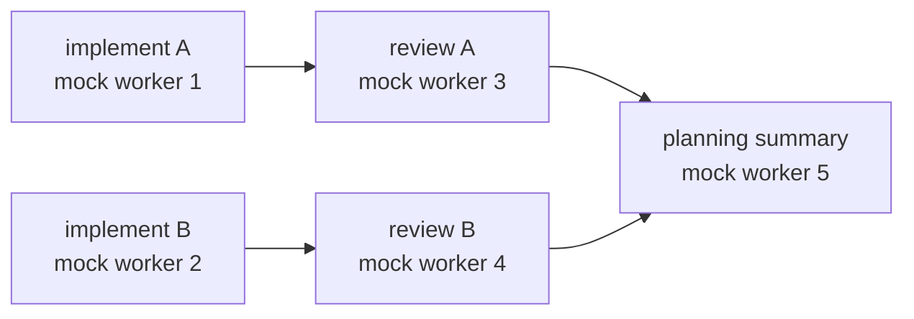

# Windows offline orchestration MVP

This guide describes the fixed synthetic demo in the installed project wheel.
It is for Windows 11 x64 with 64-bit CPython 3.12.x and a fresh, externally
located wheel-check virtual environment. Follow
[Windows 11 local setup](WINDOWS_312_LOCAL_SETUP.md) first: its strict gate
requires an independently supplied exact commit SHA, a clean checkout,
`W2A_E2E_RUN=0`, the complete non-E2E test suite and Ruff. Build the wheel and keep
the verifier JSON, wheel, wheel environment, and command output outside the
checkout. Install that exact wheel into the fresh wheel environment, then run
the commands below from a directory outside the repository so imports resolve
to the installed wheel.

The demo uses synthetic packages, mock workers, mock upload receipts and local
SQLite state. It does not contact a ChatGPT account or another provider, start
Chrome, or call a production finalizer.

## Fixed demo graph

The demo creates five fixed tasks and five distinct mock workers. Dependencies
constrain execution to three waves:



| Wave | Tasks | Workers | Parallelism |
| --- | --- | --- | ---: |
| 1 | Implement A and Implement B | Two distinct mock implement workers | 2 |
| 2 | Review A and Review B | Two distinct mock review workers | 2 |
| 3 | Planning summary | One distinct mock planning worker | 1 |

The scheduler runs two mock tasks in parallel in each of the first two waves,
then one in the last wave. This is not five simultaneous real workers. Reviews
depend on their corresponding implementation tasks; the planning summary waits
for both reviews.

Each task package is sealed and hash-checked. Mock preflight and the dispatch
outbox create assignment-bound synthetic upload receipts and intents; the
callback inbox deduplicates synthetic progress and completion. Mock completion
receipts are stored separately from task finalization. A successful demo leaves
all five tasks in `verified`; their scopes and occupied slots remain held.
`verified` and `mock_completed` do not mean a real review, merge, deployment,
or release. Production finalization remains disabled.

## Run from the installed wheel

Use a new unique label for each fresh demo. Labels are 1–40 characters and
contain only ASCII letters, digits, `_` or `-`; the first character must be a
letter or digit. The example below is 23 characters. The workspace is created
under `%LOCALAPPDATA%\chatgpt-web2api\<label>` with a Windows private ACL.

```powershell
$wheelEnv = 'C:\path\to\external\evidence\wheel-env'
$wheelPython = Join-Path $wheelEnv 'Scripts\python.exe'
$observer = Join-Path $wheelEnv 'Scripts\chatgpt-orchestrator-observer-mcp.exe'
$label = 'offline-mvp-20261022-a1'
$evidenceDir = 'C:\path\to\external\evidence\demo-output'
New-Item -ItemType Directory -Path $evidenceDir -ErrorAction Stop | Out-Null

# Safe installed-wheel CLI smokes; these display help and do not open a workspace.
Push-Location $evidenceDir
$priorPythonPath = $env:PYTHONPATH
try {
    Remove-Item Env:PYTHONPATH -ErrorAction SilentlyContinue
    & $wheelPython -m chatgpt_web2api.orchestrator --help |
        Tee-Object -FilePath (Join-Path $evidenceDir 'orchestrator-help.txt')
    if ($LASTEXITCODE -ne 0) { throw 'Orchestrator CLI help failed.' }
    & $wheelPython -m chatgpt_web2api.orchestrator demo --help |
        Tee-Object -FilePath (Join-Path $evidenceDir 'demo-help.txt')
    if ($LASTEXITCODE -ne 0) { throw 'Orchestrator demo help failed.' }
    & $observer --help |
        Tee-Object -FilePath (Join-Path $evidenceDir 'observer-help.txt')
    if ($LASTEXITCODE -ne 0) { throw 'Observer MCP help failed.' }

    # Run demo commands from outside the repository with the installed wheel.
    & $wheelPython -m chatgpt_web2api.orchestrator --json demo --label $label --action init |
        Tee-Object -FilePath (Join-Path $evidenceDir 'init.json')
    if ($LASTEXITCODE -ne 0) { throw "Demo initialization failed: $LASTEXITCODE" }

    & $wheelPython -m chatgpt_web2api.orchestrator --json demo --label $label --action doctor |
        Tee-Object -FilePath (Join-Path $evidenceDir 'doctor.json')
    if ($LASTEXITCODE -ne 0) { throw "Demo doctor failed: $LASTEXITCODE" }

    & $wheelPython -m chatgpt_web2api.orchestrator --json demo --label $label --action run |
        Tee-Object -FilePath (Join-Path $evidenceDir 'run.json')
    if ($LASTEXITCODE -ne 0) { throw "Demo run failed: $LASTEXITCODE" }

    & $wheelPython -m chatgpt_web2api.orchestrator --json demo --label $label --action status |
        Tee-Object -FilePath (Join-Path $evidenceDir 'status.json')
    if ($LASTEXITCODE -ne 0) { throw "Demo status failed: $LASTEXITCODE" }
} finally {
    Pop-Location
    if ($null -eq $priorPythonPath) {
        Remove-Item Env:PYTHONPATH -ErrorAction SilentlyContinue
    } else {
        $env:PYTHONPATH = $priorPythonPath
    }
}
```

Expected results are `ready` after initialization and `demo_complete` after a
normal run. `status` and `doctor` reopen the existing labeled workspace;
`doctor` also verifies the sealed package blobs. They do not recreate or repair
workspace data. Their summaries omit prompt text and raw worker session tokens.
Keep the JSON output outside the checkout as shown.

`init` provisions a new workspace only. If the label's workspace already
exists, initialization refuses it and leaves the existing contents in place.
Use a different unused label to start another demo. Do not pass `--db`, set
`CHATGPT_ORCHESTRATOR_DB`, or add `--private-workspace` to a `demo` command;
the demo owns its labeled private workspace and rejects those overrides.

## Simulate a lost process

For recovery behavior, use a separate new label and intentionally stop after
the first mock send intent is persisted:

```powershell
$priorPythonPath = $env:PYTHONPATH
Remove-Item Env:PYTHONPATH -ErrorAction SilentlyContinue
$label = 'offline-crash-20261022-a1'
try {
    & $wheelPython -m chatgpt_web2api.orchestrator --json demo --label $label --action init
    if ($LASTEXITCODE -ne 0) { throw 'Demo initialization failed.' }

    & $wheelPython -m chatgpt_web2api.orchestrator --json demo --label $label --action run --crash-after-intent
    $crashExitCode = $LASTEXITCODE
    if ($crashExitCode -ne 17) { throw "Expected synthetic exit 17, got $crashExitCode." }

    & $wheelPython -m chatgpt_web2api.orchestrator --json demo --label $label --action run
    $restartExitCode = $LASTEXITCODE
    if ($restartExitCode -ne 2) { throw "Expected needs_human exit 2, got $restartExitCode." }
} finally {
    if ($null -eq $priorPythonPath) {
        Remove-Item Env:PYTHONPATH -ErrorAction SilentlyContinue
    } else {
        $env:PYTHONPATH = $priorPythonPath
    }
}
```

The intentional crash emits no final JSON because the demo process exits with
code 17. On restart, the durable intent is quarantined as uncertain and the
summary reports `needs_human`; no new intent, resend, or re-upload is issued.
Do not retry that label or run `init` on it. The conservative recovery state is
part of the demo contract.

## Read-only Observer MCP

The installed wheel provides a separate stdio observer with eight read-only
tools. Start it with the same existing workspace label from outside the
checkout:

```powershell
$observer = Join-Path $wheelEnv 'Scripts\chatgpt-orchestrator-observer-mcp.exe'
& $observer --private-workspace $label
```

The tools are `orchestrator_capabilities`, `orchestrator_status`,
`orchestrator_events`, `orchestrator_callbacks`, `orchestrator_workers`,
`orchestrator_reviews`, `orchestrator_proposals`, and `orchestrator_evidence`.
The observer reads the local protected workspace; it has no dispatch, provider,
or finalization operation. Configure it as an MCP stdio process in the client
that will use the observer. Do not combine `--private-workspace` with `--db` or
`CHATGPT_ORCHESTRATOR_DB`.

## Support boundary

- Supported storage coordination is Model 1: cooperating processes using the
  validated private Windows workspace.
- Model 2, hostile same-user filesystem swaps and general Windows TOCTOU
  resistance remain **FAIL / unsupported**.
- Effective read/write/delete denial for a second Windows user is **NOT
  TESTED**; no restricted second-user test token is available.
- The demo creates no real workers, provider sessions, remote uploads, reviews,
  merges, or production finalization authority. Mock receipts are synthetic
  local evidence only.
- A strict local verification result and installed-wheel smoke confirm only
  the checked local tree and package entry points. They do not authenticate CI,
  account/session access, real model or app selection, hosted behavior, or
  production readiness.
